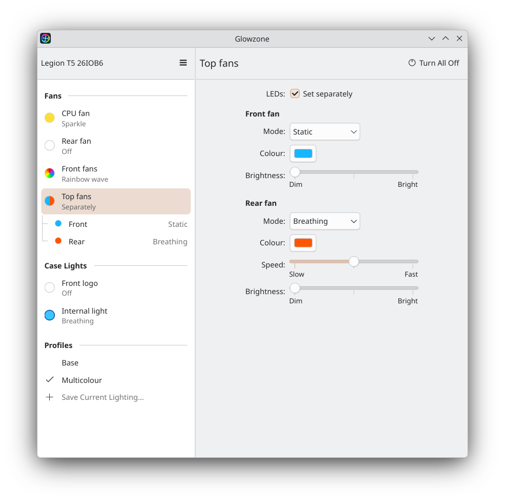

# Glowzone

Lighting control for supported Lenovo desktops on Linux – the fan LEDs and the
case lights, as Lenovo Vantage does on Windows. A KDE Plasma app with a
command-line tool and profiles.



> **Vibecoded.** Written with an AI assistant (Claude) and reviewed by me, for
> my own machine. It works for me; read the code before you trust it with yours.
> [Bug reports](https://github.com/Meluxon/glowzone/issues) and captures from
> other models are welcome.

## Supported models

| Model | Fans | Case lights |
|---|---|---|
| Legion T5 26IOB6 (board 3733) | CPU, rear, front ×2, top ×2 | front logo, internal light |

Glowzone checks the model (DMI) and refuses to run on anything else – there is
no `--force`, because the wiring differs between models. Adding one means
capturing Vantage on Windows; see [docs/development.md](docs/development.md).

## What runs as root

The fan LEDs are reached as your user. The case lights need a small root
helper, started on demand: it runs **without a password** for whoever is at the
active local session, only on the models listed above, and only accepts the
light settings that model allows. What it does, and how that is tested:
[docs/security.md](docs/security.md).

## Install

**Arch Linux:**

```sh
cd packaging/arch
makepkg -si
```

**Other distributions** need Qt ≥ 6.7 with Qt SVG, KDE Frameworks 6 (KAuth with the
polkit backend, KCoreAddons, KDBusAddons, KI18n, KStatusNotifierItem,
KWidgetsAddons), extra-cmake-modules,
hidapi (hidraw), polkit, CMake and a C++20 compiler. Then:

```sh
./scripts/install.sh
```

It builds, runs the tests and installs into `/usr` with sudo, keeping a list
of the installed files so `./scripts/uninstall.sh` can remove them all.

**For the case lights** also install the `acpi_call` kernel module (on Arch
`acpi_call-dkms`, or `acpi_call` / `acpi_call-lts` for your kernel). Glowzone
loads it when needed – nothing is set up at boot.

## Use

Start **Glowzone** from the application menu. Pick a fan or light in the
sidebar and set its mode, colour, speed and brightness; changes apply at once.
Double fans can be **set separately**. Click a profile to apply it,
*Save Current Lighting…* to make one; right-click to rename or delete.

**CPU temperature** is a mode like the others: an LED in it changes colour
with the CPU temperature – blue when cool, through green and yellow, to red
when hot – while other fans keep their own effects. *Coolest* and *Hottest*
set the temperatures the colours are spread over (shared by all fans in the
mode, saved in profiles); below the range the colour fades towards dark, above
it towards white. The default range, 35–100 °C, gives Vantage's colours.
Glowzone has to be running
for that: turn on *Keep Running in Background* in the ☰ menu to keep it in the
system tray when the window is closed, and *Start at Login* to start it there.
Both are off by default.

The same from a terminal:

```sh
glowzone status
glowzone fan all rainbow -s 1 -b 2
glowzone fan top static -c 0000ff --led rear   # one LED of a double fan
glowzone fan cpu cpu-temperature -r 35-80      # follows the CPU temperature, colours over 35–80 °C
glowzone light logo on -b 1
glowzone profile apply night
glowzone reset                                 # everything off, colours and levels reset
glowzone --help                                # the fans, lights and modes of your machine
```

`glowzone profile apply <name>` works well as a Plasma global shortcut
(System Settings → Keyboard → Shortcuts → Add New → Command or Script).

Good to know:

- The fan controller can't be read back, so Glowzone shows what it last sent.
  The case lights are read from the firmware.
- After a cold start the BIOS sometimes doesn't detect a fan that isn't
  spinning yet. Glowzone tells you, and changes nothing: profiles stay as they
  are and every LED still gets its settings.
- Changing a case light can stall the PC for a moment (a BIOS call; Vantage
  does the same on Windows), so its sliders apply when you let go.
- The CPU-temperature colours follow the CPU's own sensor, read as your user –
  Vantage reads the embedded controller instead, which would need root. The
  colours match Vantage's for a steady temperature (with the default range);
  while it changes fast they may be a step apart for a few seconds.

## Uninstall

```sh
./scripts/uninstall.sh    # asks before each step; -y answers yes to all
```

It offers to turn the lights off and to delete your settings and profiles,
then removes the program and checks that nothing is left. With `pacman -Rns glowzone`
alone, the lights keep their last setting and your files in
`~/.config/glowzone` and `~/.local/state/glowzone` (and the login start in
`~/.config/autostart`) stay.

## More

- [docs/security.md](docs/security.md) – what runs as root, what it accepts,
  and how that is tested.
- [docs/development.md](docs/development.md) – building, tests, the fuzzer,
  translations, adding a model, installed files.

Translations: Polish (by the author), German (partly reviewed), French and
Japanese (AI drafts, not yet reviewed – corrections very welcome).

## License

GPL-2.0-or-later. See `LICENSES/`.
